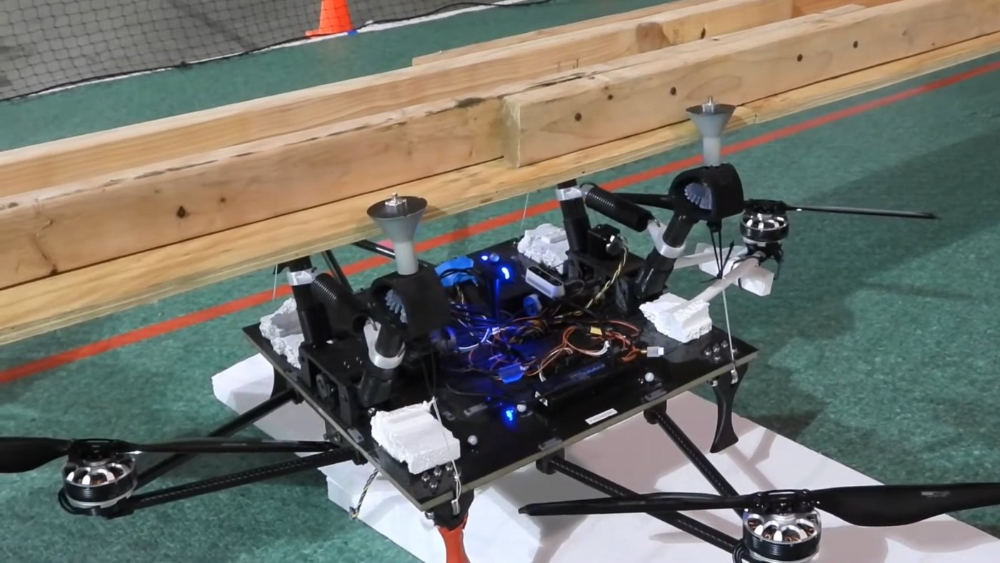
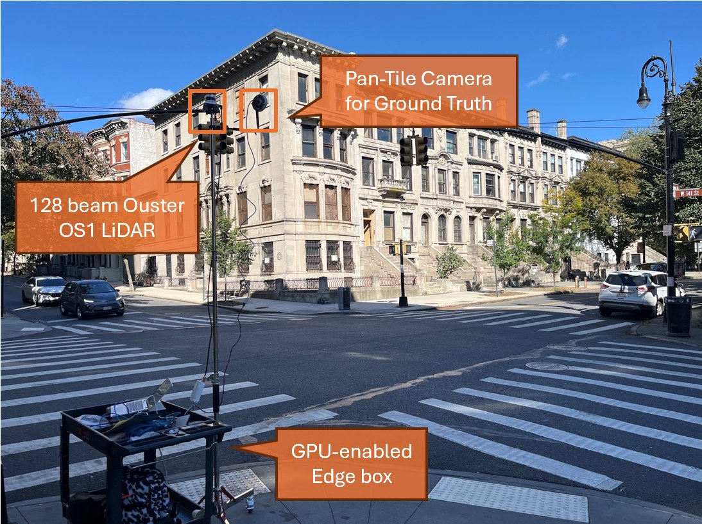
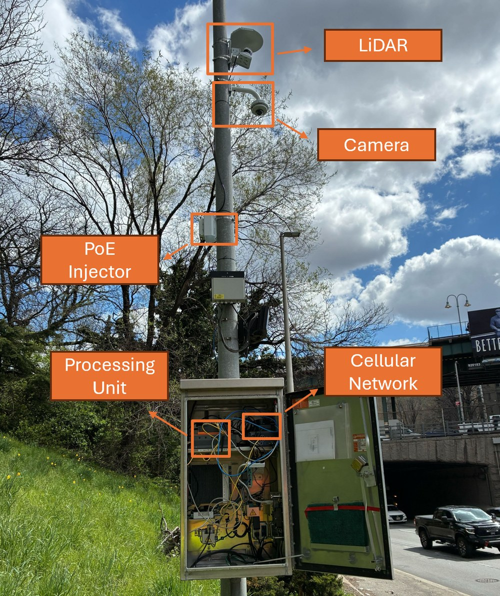

  
EMBODIED ROBOTICS · ROADSIDE 3D LIDAR · GEOSPATIAL AI

  <h1>Bo Shang</h1>
  
Robotics &amp; AI Researcher · Postdoctoral Associate, University of Maryland

  

    My research asks how the infrastructure around us — bridges, intersections, highways, and cities — can perceive itself. Combining <strong>embodied field robots</strong> with <strong>fixed 3D sensing and auditable AI simulation</strong>, I build physical-AI systems deployed with public transportation agencies.
  

  

    <a href="/portfolio/" class="home-btn home-btn--primary"><i class="fas fa-cubes" aria-hidden="true"></i> Explore Systems Portfolio</a>
    <a href="/slides/mechatronics/" class="home-btn home-btn--ghost"><i class="fas fa-microchip" aria-hidden="true"></i> Mechatronics Slides</a>
    <a href="/slides/" class="home-btn home-btn--ghost"><i class="fas fa-tv" aria-hidden="true"></i> Infrastructure AI Slides</a>
    <a href="/cv/research/" class="home-btn home-btn--ghost"><i class="fas fa-file-lines" aria-hidden="true"></i> Research Resume</a>
  

  

    

      US 12,296,994
      Granted U.S. Patent &amp; ASCE 2025 Pankow Award (BIRDS)
    

    

      0.37 → 1.00
      PACO Intersection Observability (ADAS vs. Roadside V2I)
    

    

      61.9 Hours
      InfraLiDAR-Eval Continuous Highway 3D Benchmark
    

    

      cerra.cloud
      Live Geospatial AI &amp; LLM-SUMO Platform at UMD
    

  

Since July 2026, I have been a Postdoctoral Associate in Civil and Environmental Engineering and the Maryland Transportation Institute at the University of Maryland, College Park, working under Professor Xianfeng Yang. I support hardware and software development, integration, testing, troubleshooting, data collection, technical documentation, and deliverables for two sponsored transportation research projects. My broader work brings together learning-based perception, ROS-based robotics, edge inference, and inspection workflows developed with public agencies. At UMD I am extending the macro scale to the city: I build and operate [CERRA](https://cerra.cloud) (Civil, Environmental, Road &amp; Resource Analytics), a platform that turns real-world infrastructure data into actionable insight, including an LLM-driven traffic simulation and a quantum-safe evaluation of signal broadcast.

## Research: Intelligent Infrastructure Across Scales

  

    
    

      Micro · Structural Robotics
      <h3 class="home-scale-card__title">Embodied Bridge &amp; Concrete Robots</h3>
      
UAVs and climbing robots operating where GPS fails: the patented BIRDS flying-clamping bridge robot (6 experimental videos) and 3D concrete crack localization (<em>IEEE T-ASE</em> 2025).

      <a href="/portfolio/portfolio-2/" class="home-scale-card__link">Watch BIRDS flight &amp; clamping demos →</a>
    

  

  

    
    

      Meso · Urban Intersections
      <h3 class="home-scale-card__title">PACO &amp; Roadside Safety Auditing</h3>
      
A 120° ADAS observes 0.37 of an urban intersection, a 360° AV 0.61, and elevated roadside LiDAR (V2I) 1.00 — proving dynamic occlusion makes infrastructure sensing mathematically necessary.

      <a href="/portfolio/paco-safety-auditing/" class="home-scale-card__link">Try interactive PACO simulator →</a>
    

  

  

    
    

      Macro &amp; City · Corridors &amp; CERRA
      <h3 class="home-scale-card__title">InfraLiDAR-Eval &amp; CERRA Platform</h3>
      
61.9-hour continuous highway LiDAR evaluation (90.1% vs. 72.9% crossing recovery on I-95) scaled up to city-level geospatial AI and LLM-SUMO traffic simulation.

      <a href="/portfolio/portfolio-1/" class="home-scale-card__link">Explore highway &amp; city systems →</a>
    

  

The three scales feed one model: fixed sensors contribute macro-level intelligence, embodied robots contribute micro-level agility, and the synthesis is a unified, multi-scale picture of the built environment. **[View all 7 interactive system showcases →](/portfolio/)**

## Resume, CV &amp; Presentation Suite

  

    
Research Scientist Resume

    
Selected research contributions, deployed field systems, publications, and robotics/ML stack.

    

      <a href="/cv/research/">Web View</a>
      <a href="/assets/cv-research-scientist.pdf">Download PDF</a>
    

  

  

    
Academic CV

    
Complete record of academic appointments, publications, patents, teaching, and service.

    

      <a href="/cv/">Web View</a>
      <a href="/assets/cv.pdf">Download PDF</a>
    

  

  

    
Mechatronics Research Statement Slides

    
26-slide faculty research statement deck: BIRDS electro-mechanics, fractional-order UAV control, 3D robotic NDT &amp; 5-year lab plan.

    

      <a href="/slides/mechatronics/">Interactive Web</a>
      <a href="/assets/slides/Bo_Shang_Mechatronics_Research_Slides.pdf">PDF</a>
      <a href="/assets/slides/Bo_Shang_Mechatronics_Research_Slides.pptx">PPTX</a>
    

  

  

    
Infrastructure &amp; Physical AI Slides

    
28-slide multi-scale seminar deck with inline experimental videos, PACO observability, InfraLiDAR-Eval &amp; CERRA.

    

      <a href="/slides/">Interactive Web</a>
      <a href="/assets/slides/Bo_Shang_Research_Slides.pdf">PDF</a>
      <a href="/assets/slides/Bo_Shang_Research_Slides.pptx">PPTX</a>
    

  

## Research notes

- **[AI Agent Security After 29 Attempts](/posts/2026/09/ai-agent-security-postmortem/)** — a source-first postmortem on replay noise, public-leaderboard overfitting, counterbalanced experiments, and the private-guardrail reset.
- **[When Should a Language Model Hand Over the Controls?](/posts/2026/09/minecraft-local-agent-control/)** — an embodied-control case study comparing screenshot-mediated LLM control with a deterministic local skill worker across 39 logged runs.

## Selected publications

Selected work in urban freight sensing, roadside LiDAR, vulnerable-road-user safety, and robotic infrastructure inspection.


